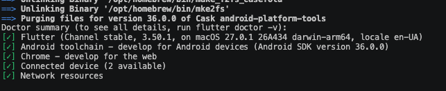
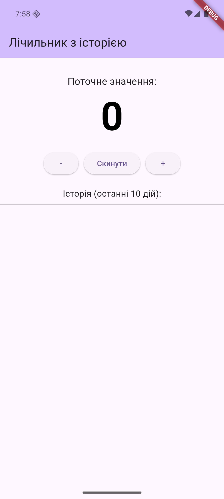
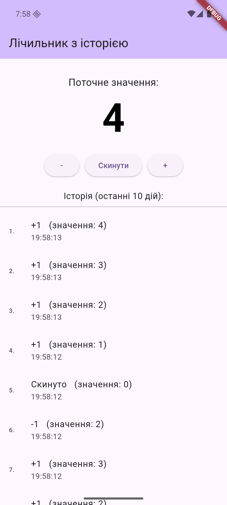
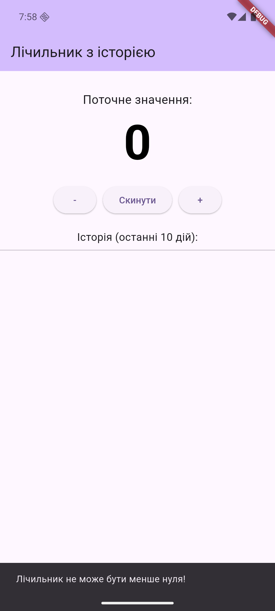
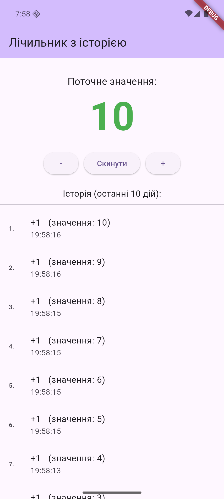
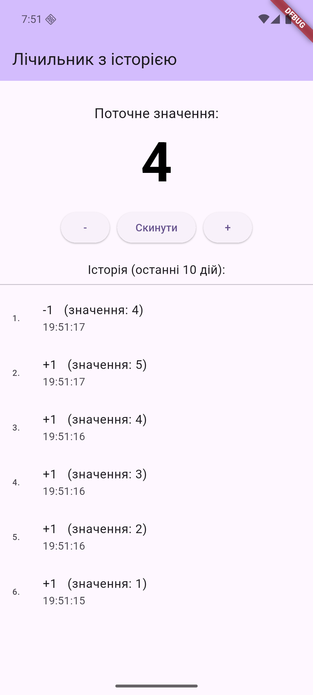
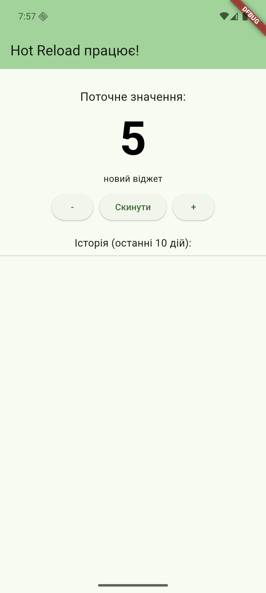

# Практична робота 3 — Hello World в Flutter

**Рукавіцин Юрій, група аІк-43**

Варіант 3: Лічильник з історією

## Що зроблено

Зробив лічильник, який запам'ятовує свої зміни. Що вміє:

- кнопки «+», «-» і «Скинути»;
- показує список останніх 10 дій з часом (нові зверху);
- не дає піти в мінус — якщо натиснути «-» на нулі, знизу з'являється повідомлення;
- коли значення кратне 10 (10, 20, ...), цифра стає зеленою. 0 не підсвічую, бо це початкове значення.

Список історії зроблений через `ListView.builder`, запис історії — окремий клас `HistoryItem` у своєму файлі.

Файли:

- `lib/main.dart` — запуск і `MaterialApp`
- `lib/counter_page.dart` — головний екран (`StatefulWidget`), тут уся логіка лічильника
- `lib/history_item.dart` — клас запису історії (дія, значення, час)

У `dispose()` звільняю `ScrollController` списку (він потрібен, щоб після нової дії список прокручувався наверх).

`flutter analyze` — No issues found!

## Як запустити

Потрібен Flutter (я робив на 3.50.1) і Android SDK з емулятором.

```
flutter pub get
flutter run
```

Емулятор треба запустити заздалегідь (Android Studio → Device Manager, або `flutter emulators --launch <назва>`).

Є один простий тест: `flutter test`.

## Скриншоти

flutter doctor:



Застосунок на емуляторі (Pixel 8, Android 16):

   

На реальному телефоні не запускав — немає Android-телефону.

## Hot Reload / Hot Restart

Перед кожною зміною накликав якесь значення і кілька записів в історії, щоб було видно, чи зберігається стан. Потім змінював код і робив Hot Reload (`r`), а якщо зміна не з'являлась — Hot Restart (`R`).

| # | Що змінив | Hot Reload спрацював? | Стан зберігся? |
|---|---|---|---|
| 1 | текст заголовка в AppBar | так | так |
| 2 | колір теми (`seedColor` deepPurple → green) | так | так |
| 3 | додав новий віджет `Text` під лічильником | так | так |
| 4 | початкове значення `_counter = 0` → `5` | ні, на екрані лишилось старе значення | так |
| 5 | змінив `main()` (обгорнув `MyApp` у `Banner`) | ні, банер не з'явився | так |
| 6 | додав нове поле в клас State і вивів його на екран | так | так |

Після Hot Restart зміни з пунктів 4 і 5 з'явились (лічильник став 5, з'явився банер), але стан скинувся — історія очистилась.

До змін / після Hot Reload (заголовок змінився, а лічильник та історія ті самі) / після Hot Restart (лічильник 5, історія порожня):

  

**Чому так.** Hot Reload підвантажує змінений код у Dart VM, яка вже працює, і заново викликає `build()` у віджетів. Але об'єкти, які вже створені (зокрема `State`), не створюються заново, тому значення їхніх полів залишаються. Тому все, що всередині `build()` (текст, колір, нові віджети), оновлюється, а стан зберігається. Колір теж оновився, бо `ThemeData` створюється в `build()` у `MyApp`.

- П.4: `_counter = 0` присвоюється тільки коли створюється об'єкт State. Він уже створений, тому нове початкове значення ні на що не впливає, поки не зробиш Hot Restart.
- П.5: `main()` виконується один раз при запуску застосунку. Hot Reload його не викликає повторно, тому зміни в `main()` видно тільки після Hot Restart.
- П.6: думав, що тут буде помилка, але спрацювало — Dart VM додає нове поле в уже існуючий об'єкт і ініціалізує його значенням з коду.

Hot Restart запускає Dart-код заново з `main()`, тому всі зміни з'являються, але стан губиться. Він трохи довший: ~0.7 с проти ~0.2 с у Hot Reload.

## Труднощі

- Найдовше ставив середовище: Flutter, Android Studio, Android SDK, емулятор. Xcode у мене немає, тому `flutter doctor` показував хрестик для iOS — вимкнув iOS і macOS через `flutter config --no-enable-ios --no-enable-macos-desktop`, бо роблю під Android.
- У Flutter 3.50 `import 'package:flutter/material.dart'` вже deprecated, і `flutter analyze` на нього лається. Тепер Material в окремому пакеті, треба писати `import 'package:material_ui/material_ui.dart'` (так і в шаблоні `flutter create`).
- Hot Restart через якийсь час почав відвалюватись з помилкою `Lost connection to device`, і після цього `flutter run` не міг підключитись до застосунку. Допоміг перезапуск емулятора (Cold Boot).
