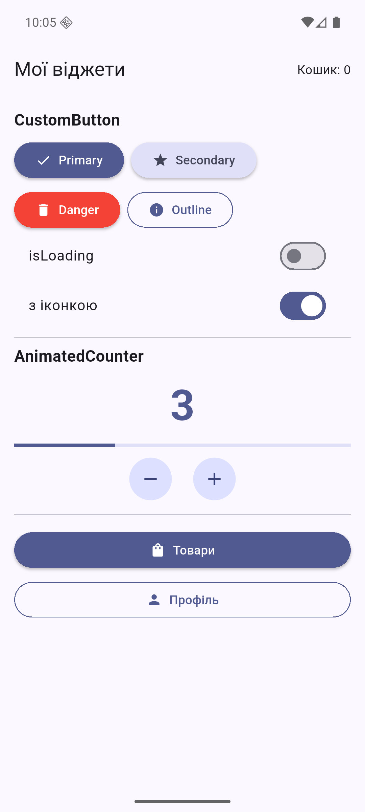
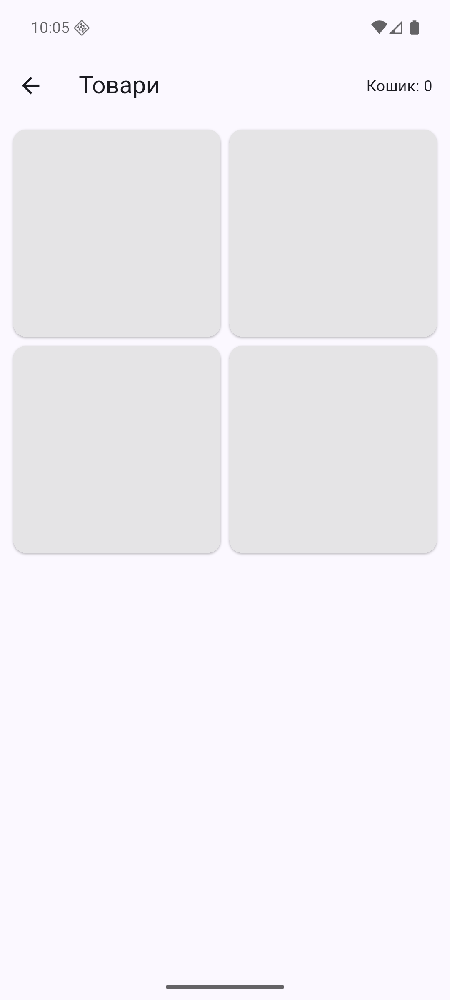
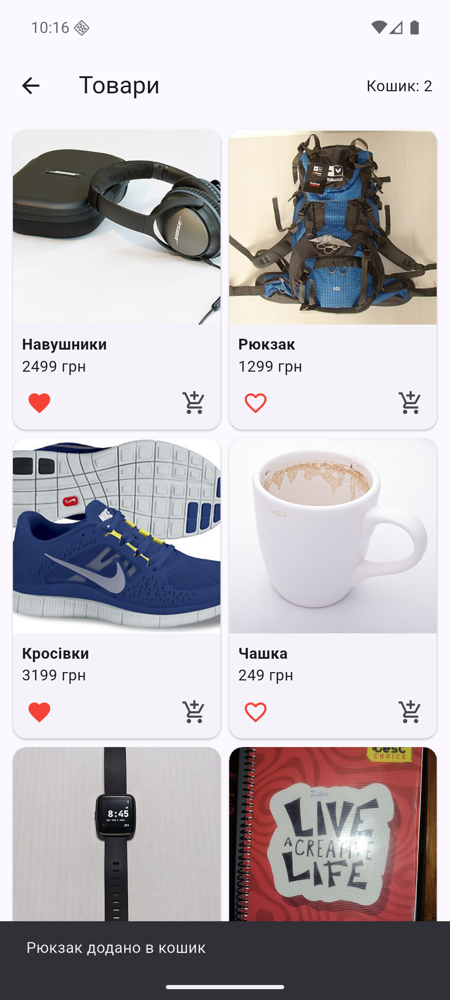
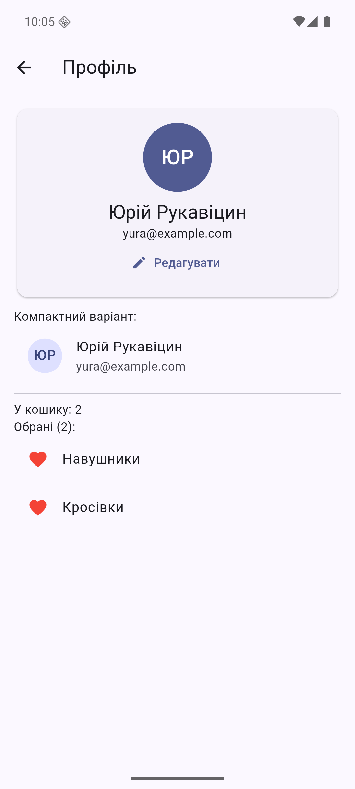

# Практична робота 5 - Віджети у Flutter

Рукавіцин Юрій, аІк-43

Невеликий додаток з кастомними віджетами: головний екран з демо віджетів, список товарів (обране, кошик) і профіль. Стан зберігається в `AppState` (ChangeNotifier + provider).

- Web версія: https://yrukavicin-cpu.github.io/Mobile/
- APK: (посилання на Google Drive)

## Запуск

Flutter 3.16+ (я робив на 3.50.1).

```
flutter pub get
flutter run
```

Web: `flutter run -d chrome`
APK: `flutter build apk --release` (файл буде в `build/app/outputs/flutter-apk/`)

Тести: `flutter test` (12 тестів), покриття `flutter test --coverage` - вийшло ~79%.

## Віджети

- `CustomButton` - кнопка з 4 стилями (primary, secondary, danger, outline), іконкою і станом завантаження
- `ProfileWidget` - профіль (аватар з ініціалами, імя, email), компактний і повний режим
- `AnimatedCounter` - лічильник: збільшується при зміні, червоніє на максимумі, кнопки стискаються, плавний прогрес
- `ProductCard` - картка товару: свайп = в обрані, тап по фото = збільшити, анімація кнопки кошика, мерехтіння поки вантажиться картинка

## Структура

```
lib/
  main.dart
  screens/   home_screen, products_screen, profile_screen
  widgets/   custom_button, product_card, profile_widget, animated_counter
  models/    user, product
  utils/     constants, themes, app_state
```

## Скріншоти

   


## Що було складно

- Flow тест не міг натиснути кнопку "Товари" бо вона була за екраном, і потім снекбар закривав кнопку "Профіль" - довелось чекати поки він сховається.
- В release APK не вантажились картинки - забув дозвіл INTERNET в AndroidManifest (в debug він є автоматично).
